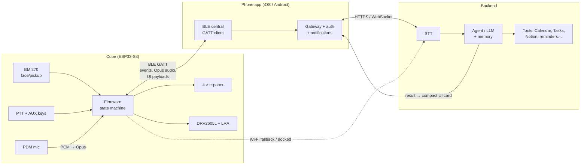
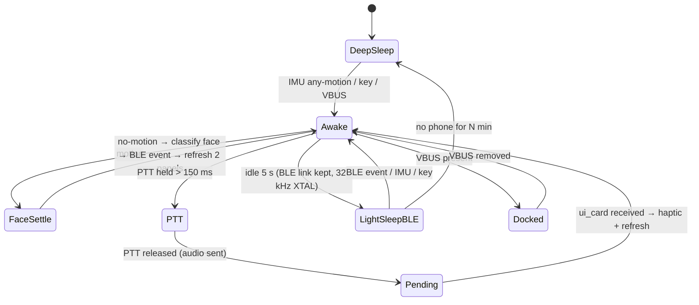

# Research — System architecture

Checked 2026-10-05. The *chosen* electronics design is in `electronics/architecture.md`; this file
records the system-level reasoning.

## 1. System architecture

### Message contract (draft)
- **Cube → phone:** `face_changed{face, ts}`, `ptt_start`, `audio_chunk{seq, opus}`, `ptt_end`, `button{id, kind}`, `battery{soc, charging, docked}`.
- **Phone → cube:** `ui_card{face|up, lines[≤4], icon, haptic}`, `context_state{face→label map}`, `focus_timer{end_ts}`, `ack{request_id, status}`.
- The cube renders **compact UI cards**, never free text from the LLM directly — the backend formats results to fit 200 × 200 px.

## 2. Why phone-as-gateway (and when Wi-Fi)
- BLE to an always-carried phone costs ~0.3–0.6 mA average (model) vs. Wi-Fi association + TLS per request.
- The phone already owns identity, permissions, notifications and location.
- **Wi-Fi role:** (1) docked Desktop Mode, where power is free and the cube can talk to the backend
  directly; (2) fallback when the phone app is killed. Never the Pocket Mode default.

## 3. Platform risk: iOS background BLE
iOS apps can stay connected as a BLE central in the background (`bluetooth-central` background mode) and
are woken on characteristic notifications, but get limited execution time and can be terminated by the
OS; state restoration helps but is not guaranteed after a user force-quit. Mitigations: queue audio in
cube PSRAM, short request/response, Wi-Fi fallback, Android-first development if iOS is flaky. Tracked
as risk R-10. (Analysis based on Apple Core Bluetooth background documentation; **not yet tested**.)

## 4. Cube firmware state machine (draft)

## 5. USB & debug architecture (Option C — D-016)
- **Service port:** internal USB-C → ESP32-S3 native USB-Serial/JTAG (GPIO19/20): flashing, console, OpenOCD/GDB without a probe.
- **Recovery:** UART0 (GPIO43/44), EN, GPIO0, 3V3, GND on Tag-Connect TC2030-style pads; BOOT key behind the face-A cap.
- **User:** never sees a port; charges on the dock.
- **Dock data:** D+/D− rings reserved, not connected in V1 (5 V-scrape hazard, `research/dock.md` §4).

## 6. What must move to the custom PCB in Phase B
Everything on the Phase A breadboard except the dev-board conveniences: module, charger/power path, gauge,
buck-boost, load switches, IMU, mic, haptic driver, 4 × panel boosters + FPC connectors, keys, LED,
service USB-C, 32 kHz XTAL, ESD, dock-pad board. The LRA and battery are wired/foam-mounted parts.
